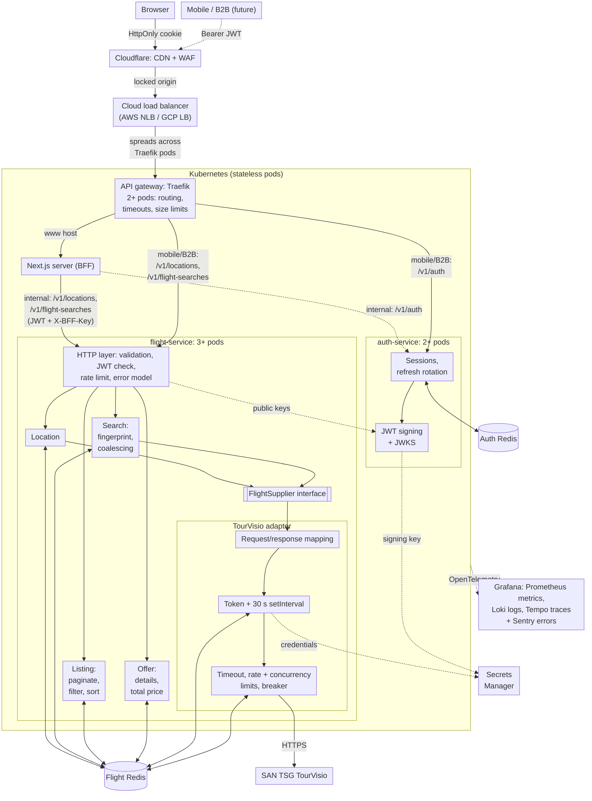
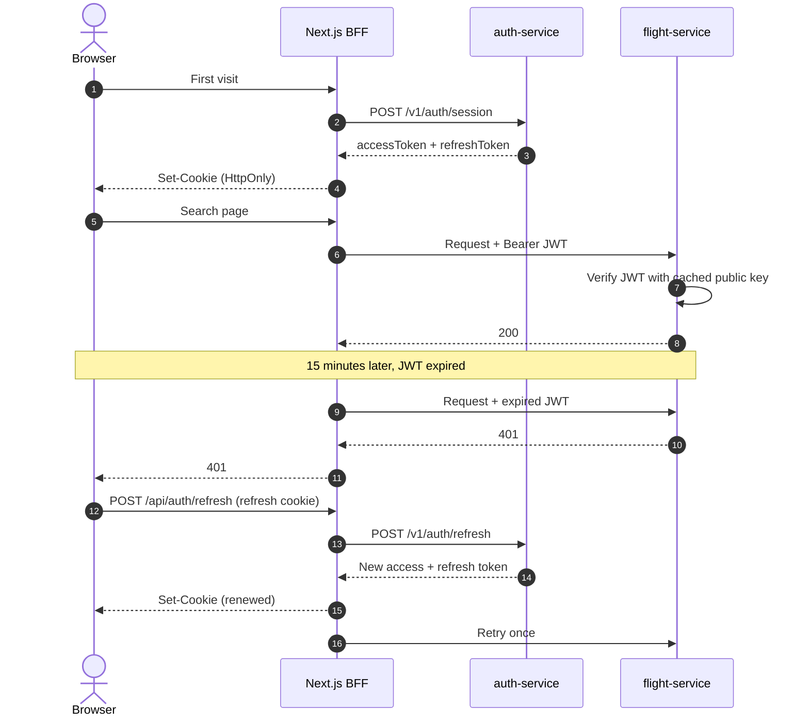
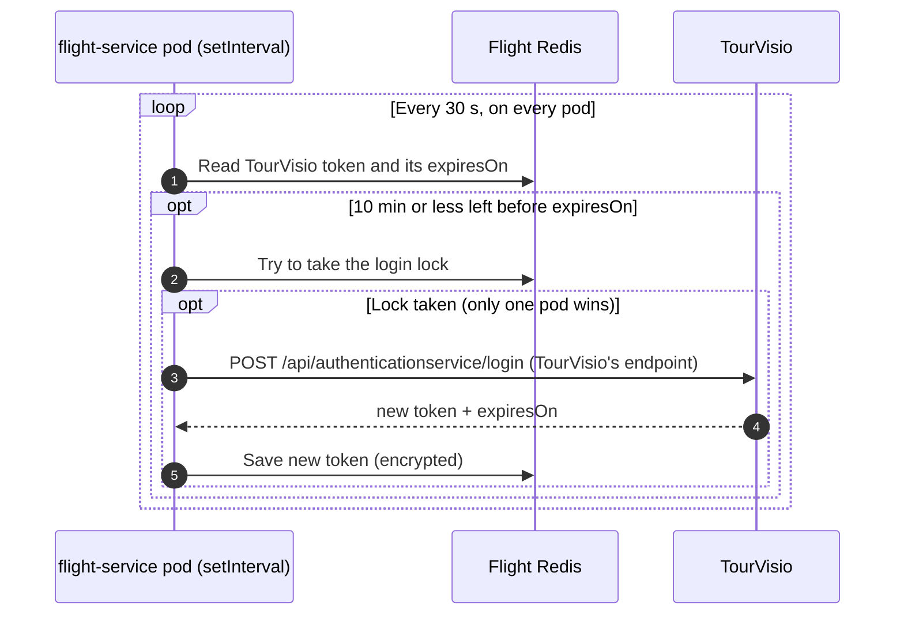
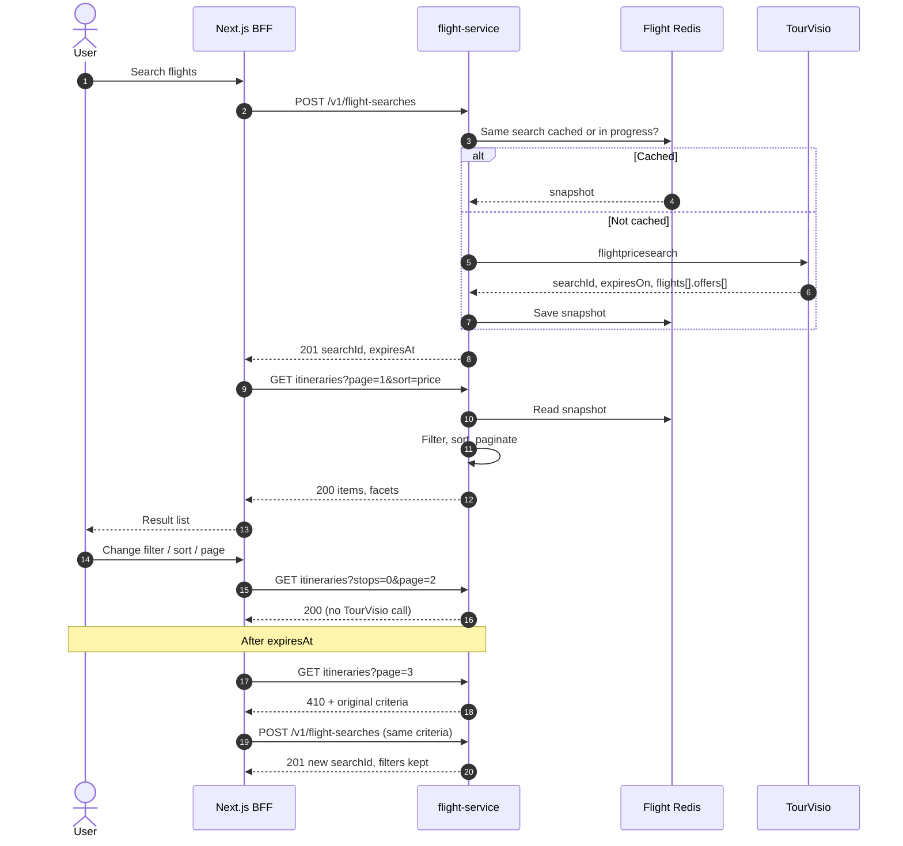
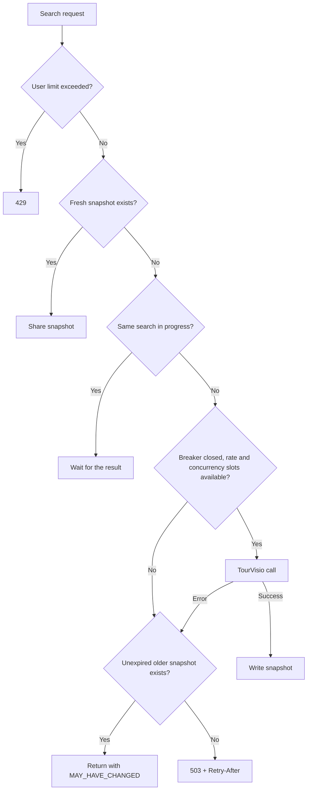

# gidiyorum.com — TourVisio Flight API Architecture Plan

> Türkçe (ana sürüm): [README.md](README.md)

> **Scope:** location selection → flight search → listing → offer details. Booking and payment are out of scope. Later, a separate `booking-service` will revalidate the chosen offer and start the TourVisio booking flow (`begintransaction`).

- **Two stateless NestJS services:** `auth-service` (sessions, JWTs) and `flight-service` (search, listing, offers, TourVisio adapter).
- **Two auth layers:** Next.js → our API uses a JWT + refresh token. Our API → TourVisio logs in again before `expiresOn` (TourVisio has no refresh token).
- **Listing never calls TourVisio:** results are stored once in Redis (a **snapshot**) and paged, filtered, and sorted there.
- **TourVisio is the bottleneck:** caching and merging identical searches cut supplier calls, and global limits cap them.
- **[DOC]** = stated in the TourVisio docs, **[Q-n]** = assumption with an [open question](#questions-for-tourvisio). Doc facts D1–D12: [docs/tourvisio-findings.en.md](docs/tourvisio-findings.en.md).

---

## 1. Technology choices

| Layer | Choice | Why |
|---|---|---|
| Language | **TypeScript + NestJS (Fastify)** | Network-bound workload, same language and types as Next.js |
| Services | **`auth-service` + `flight-service`** | Different load, secrets, and failure behavior ([Section 2](#2-architecture-diagram)) |
| Database | **None in phase one** | Search creates no durable data. PostgreSQL arrives with booking |
| Cache | **Redis** (Auth Redis + Flight Redis) | Sessions, snapshots, TourVisio token, locks, limits. Separate so a search spike can't affect sessions |
| Queue | **None in search** | The user waits for a synchronous answer. RabbitMQ arrives with booking events |
| Listing engine | **In-process, no Elasticsearch** | Each result is small, never changes, and lives ≤ 15 min, so sorting it in memory takes milliseconds |
| Edge + gateway | **Cloudflare + cloud load balancer + Traefik** | WAF/bots at the edge, routing and timeouts in the cluster |
| Runtime | **Kubernetes** | Per-service scaling, health checks, rolling deploys |
| Observability | **OpenTelemetry → Grafana, Sentry, PostHog** | One trace from Next.js to TourVisio, errors, search → offer funnel |
| Secrets | **AWS Secrets Manager + KMS** (GCP equivalents work the same) | Per-service access, audit log, rotation |

---

## 2. Architecture diagram



### Why two services?

| | `auth-service` | `flight-service` |
|---|---|---|
| Load | Short token signing | Connections held 2–8 s, large JSON |
| Secrets | JWT private key | TourVisio credentials |
| Data | Sessions | Snapshots, TourVisio token, locks |
| If it fails | Existing JWTs work ≤ 15 min | Sessions keep working, search `503` |

- **Search, listing, and offers stay together:** they share one snapshot, so splitting adds a hop to every listing request.
- **Cost accepted:** two deployments, key rollover, cross-service tracing.

### Components

| Component | In this plan |
|---|---|
| API gateway | Cloudflare (WAF, bots, TLS) → cloud load balancer → Traefik (routing, timeouts, size limits) |
| Auth | `auth-service` issues JWTs. Each service verifies them locally |
| Flight service | `flight-service`: location, search, listing, offer |
| TourVisio adapter | Inside `flight-service`, behind the `FlightSupplier` interface. Only the adapter knows TourVisio fields |
| Cache | Flight Redis, Auth Redis, Cloudflare CDN for autocomplete |
| Logs / monitoring | OpenTelemetry → Grafana (metrics, logs, traces), Sentry |

- **Locked origin:** the load balancer accepts only Cloudflare IPs plus our Cloudflare client certificate, so nobody can skip the WAF.
- **Load balancing:** the load balancer spreads across Traefik pods, and Traefik spreads across all ready service pods. Pods are stateless, so any pod serves any request.

---

## 3. Method plan

**Common rules:** base path `/v1`. Every call except auth needs `Authorization: Bearer <JWT>`. Errors use RFC 9457 `problem+json`.

### 3.1 Auth (Next.js → `auth-service`)

| | Open session | Refresh | Logout |
|---|---|---|---|
| Endpoint | `POST /v1/auth/session` | `POST /v1/auth/refresh` | `POST /v1/auth/logout` |
| Input | — | `refreshToken` | `refreshToken` |
| Output | `accessToken` (15 min), `refreshToken` (24 h) | New token pair | `204` |
| TourVisio | None. `flight-service` logs in to TourVisio separately ([4.2](#42-flight-service--tourvisio-continuous-session-with-a-timer)) | None | None |
| Cache | Refresh token hash in Auth Redis | Old token marked used | Session revoked |
| Errors | `429` too many sessions, `503` | `401` expired, reused, or past 7 days, `503` | `503` |

- **Guest sessions** in phase one: search needs no login. Member login later uses the same model.
- **Refresh token:** single-use, replaced on every refresh. Session ends after 24 h idle or **7 days** total.

### 3.2 Location search

| | Plan |
|---|---|
| Endpoint | `GET /v1/locations/departures?q=ist` · `GET /v1/locations/arrivals?q=ayt&originId=AIRPORT:IST` |
| Input | `q` (≥ 2 chars), `tripType`, `locale`, `originId` for arrivals |
| Output | `items[]: { id: "AIRPORT:SAW", type, code, name }` |
| TourVisio | `getdepartureautocomplete`, `getarrivalautocomplete` [DOC] |
| Cache | Redis 24 h + Cloudflare CDN 5 min |
| Errors | `400` bad query, `401`, `429`, `502` supplier error, `504` timeout |

### 3.3 Flight search

| | Plan |
|---|---|
| Endpoint | `POST /v1/flight-searches` |
| Input | `tripType`, `originId`, `destinationId`, `departureDate`, `returnDate?`, `passengers`, `currency` |
| Output | `201`: `searchId`, `resultCount`, `freshUntil`, `expiresAt` |
| TourVisio | `flightpricesearch` [DOC]. Round trip: `ServiceTypes: ["2"]` + `Night` |
| Cache | Same search within 3 min shares one result. Identical searches in progress are merged into one call |
| Errors | `400`, `401`, `422` invalid dates or passengers, `429`, `502`, `503` overloaded, `504` timeout |

- Our `searchId` is per user. TourVisio's `searchId` stays on the server.

### 3.4 Listing

| | Plan |
|---|---|
| Endpoint | `GET /v1/flight-searches/{searchId}/itineraries` |
| Input | `page`, `pageSize`, `sort=price\|duration\|departure`, `airlines`, `stops`, `departureFrom/To`, `leg=OUTBOUND\|RETURN` |
| Output | `items[]`, `pagination`, `facets`, `expiresAt` |
| TourVisio | **None**: reads the snapshot |
| Cache | Snapshot in Redis, never changes |
| Errors | `400` bad filter, `404` not found or not yours, `410` expired |

- Every request filters → sorts → pages the full snapshot. No state on the server.
- Round trip: outbound list first, then returns compatible with the chosen outbound (`groupKeys`, D8).

### 3.5 Offer details

| | Plan |
|---|---|
| Endpoint | `GET /v1/flight-searches/{searchId}/offers/{offerId}` |
| Input | `searchId`, `offerId`, `returnOfferId` for round trips |
| Output | Segments, baggage, package (brand), price breakdown per passenger type, total |
| TourVisio | **None**: data is in `offers[]` (D7) |
| Cache | Same snapshot |
| Errors | `404`, `410 OFFER_EXPIRED`, `422` incompatible outbound/return |

- **No `getfarerules`:** it needs a booking transaction (D11). Fare rules are shown after booking starts.
- **Total price** follows the documented rule (D9):

```text
one-way:     offer.price + fees.oneWay
round trip:  base = both packages ? max(out.price, ret.price) : out.price + ret.price
             same fees.key ? base + max(out.fees.roundTrip, ret.fees.roundTrip)
                           : base + out.fees.oneWay + ret.fees.oneWay
```

### 3.6 Error codes

| HTTP | When | Client does |
|---|---|---|
| `401` | JWT expired | Refresh, retry once |
| `404` | Search missing or someone else's | New search |
| `410` | Result or offer expired | Search again automatically / back to list |
| `422` | Business rule (dates, passengers) | Show message |
| `429` / `503` | Limit or no capacity | Retry after `Retry-After` |
| `502` / `504` | TourVisio error / timeout | User may retry |

---

## 4. Auth and listing flows

### 4.1 Next.js → our backend: JWT + refresh token



| Token | Lifetime | Stored |
|---|---|---|
| Access JWT | 15 min | `HttpOnly` cookie. Verified with `auth-service`'s public key (JWKS) |
| Refresh token | 24 h idle, 7 days max | `HttpOnly` cookie, only sent to `/api/auth`. Hash in Auth Redis |

- **JavaScript can't read either token** (XSS), and `SameSite` + `Origin` check stop CSRF.
- **Stolen refresh token:** reusing an old one ends the whole session.
- **When it expires:** refresh → new pair. After 7 days → new guest session.

### 4.2 `flight-service` → TourVisio: continuous session with a timer



- **No refresh token in TourVisio** [DOC], so we log in again 10 min before `expiresOn`.
- **Stored:** encrypted in Flight Redis, shared by all pods. Each pod keeps a copy in memory.
- **Login fails:** the old token still works. ~20 retries fit in the 10 min window, plus an alert.

### 4.3 Search and listing flow



### 4.4 Result storage and `expiresOn` behavior

```text
safeExpiry = TourVisio expiresOn - 60 s              // margin for user action and clock drift
freshUntil = min(created + 3 min,  safeExpiry)       // new users may share it
expiresAt  = min(created + 15 min, safeExpiry)       // the searching user may browse it
```

| Time | New identical search | Existing user |
|---|---|---|
| before `freshUntil` | Shares the snapshot | `200` |
| until `expiresAt` | New TourVisio call | `200`, "prices may have changed" |
| after `expiresAt` | New TourVisio call | `410` → automatic new search |

- **Why only 3 min shared:** TourVisio's `expiresOn` (~210 min in samples) keeps IDs valid, not seats or prices (Q-4).
- **Each offer has its own `expiresOn`:** expired offers are hidden. Opening one → `410 OFFER_EXPIRED`.
- **Empty results** cached only 60 s, so retries don't spend quota.
- **Search ticket** (owner + criteria) is kept 2 h, so an expired search returns `410` + criteria instead of `404`.

### 4.5 Sample requests and responses

**Search — `POST /v1/flight-searches`**

```json
{
  "tripType": "ROUND_TRIP",
  "originId": "CITY:IST",
  "destinationId": "AIRPORT:AYT",
  "departureDate": "2027-02-17",
  "returnDate": "2027-02-24",
  "passengers": { "adults": 2, "children": 1, "infants": 0 },
  "currency": "TRY"
}
```

```json
{
  "searchId": "srch_01JD8Z7K4V9YQ2M6T3R5N8P1XA",
  "resultCount": { "outbound": 42, "return": 38 },
  "freshUntil": "2026-11-23T10:03:00Z",
  "expiresAt": "2026-11-23T10:15:00Z"
}
```

**Listing — `GET .../itineraries?leg=OUTBOUND&sort=price&stops=0&airlines=TK&page=1&pageSize=20`**

```json
{
  "items": [
    {
      "itineraryId": "itn_7f3a",
      "cheapestOfferId": "off_91c2",
      "airline": { "code": "TK", "name": "Turkish Airlines" },
      "departure": { "airport": "IST", "localTime": "2027-02-17T06:45" },
      "arrival": { "airport": "AYT", "localTime": "2027-02-17T07:55" },
      "durationMinutes": 70,
      "stops": 0,
      "price": { "amount": "2145.90", "currency": "TRY" }
    }
  ],
  "pagination": { "page": 1, "pageSize": 20, "totalItems": 7, "totalPages": 1 },
  "facets": { "airlines": [{ "code": "TK", "count": 5 }], "stops": [{ "value": 0, "count": 7 }] },
  "expiresAt": "2026-11-23T10:15:00Z"
}
```

**Expired — `410`**

```json
{
  "status": 410,
  "code": "SEARCH_EXPIRED",
  "criteria": { "tripType": "ROUND_TRIP", "originId": "CITY:IST", "destinationId": "AIRPORT:AYT", "departureDate": "2027-02-17", "returnDate": "2027-02-24", "passengers": { "adults": 2, "children": 1, "infants": 0 } }
}
```

---

## 5. System access

```text
Browser → Cloudflare → Load balancer → Traefik → Next.js server (BFF)
                                                        │ internal call (stays in the cluster)
                                                        ▼
Mobile ──→ Cloudflare → Load balancer → Traefik ──→ auth-service / flight-service → TourVisio
B2B ─────→ Cloudflare → Load balancer → Traefik ──┘
```

- **Web uses the Next.js server (BFF):** cookies and SSR stay in Next.js. Next.js calls the API inside the cluster, because the browser request already passed Cloudflare's WAF.
- **Mobile and B2B call the same API** through Cloudflare. No new service, only a new identity and limit policy.
- **Real user IP:** mobile/B2B from Cloudflare's `CF-Connecting-IP`. Web: Next.js forwards it in `X-End-User-IP`, trusted only with the `X-BFF-Key` secret.

| Client | Identity | Limit |
|---|---|---|
| Web | JWT + refresh token in `HttpOnly` cookies | Per session + IP |
| Mobile (future) | Same tokens, stored in Keychain/Keystore | Per user/device |
| B2B (future) | Client credentials per agency | Contract quota |

### Secret management

| Secret | Where | Who can read |
|---|---|---|
| TourVisio agency/user/password | AWS Secrets Manager | `flight-service` only |
| JWT private key | AWS Secrets Manager | `auth-service` only (others get public keys) |
| `X-BFF-Key`, Redis passwords | AWS Secrets Manager | The services that use them |
| Passenger data key (future) | AWS KMS | Future `booking-service` |

- **Never in** the repo, images, logs, or `NEXT_PUBLIC_*`. Secret scanning in CI blocks leaks.
- **Rotation without downtime:** services cache secrets for 10 min and refetch when one is rejected, so no pod restarts. Old and new values both work for a short overlap.

---

## 6. Security

| Threat | Mitigation |
|---|---|
| **Bots / scraping** | Cloudflare bot rules, per-session and IP limits, challenge on suspicious traffic |
| **TourVisio quota exhaustion** | Per-session search limit, caching, merging identical searches, global supplier limits |
| **Token leak** | 15 min JWT, `HttpOnly` cookies, refresh reuse ends the session, TourVisio token never leaves the server |
| **Another user's `searchId`** | Random ID + owner check on every request → `404`. TourVisio IDs never exposed |
| **Skipping the WAF** | Origin accepts only our Cloudflare (IP ranges + client certificate) |
| **Fake IP header** | `X-End-User-IP` only trusted with `X-BFF-Key` |
| **Secrets/PII in logs** | Allowlist logging, no raw supplier bodies |

### KVKK approach (future passenger data)

- **Collect only at booking:** search stores no TCKN, passport, or name.
- **Encrypted, separate storage:** PII never enters Redis or logs. Encrypted fields in PostgreSQL (KMS).
- **Access:** least privilege, masked display, access logs.
- **Retention:** delete or anonymize after a defined period.
- **Legal:** privacy notice, VERBIS, processor agreement with SAN TSG, cross-border transfer rules (Art. 9).

---

## 7. Scaling

### 7.1 Load: TourVisio is the bottleneck

`3,000 searches/min = 50/s`. Concurrent TourVisio calls = `calls/s × response time`.

| Cache savings | TourVisio calls/s | Concurrent (2 s) | Concurrent (8 s) |
|---:|---:|---:|---:|
| 0% | 50 | 100 | **400** |
| **60% (assumed)** | **20** | **40** | **160** |

- **More pods add API capacity, not supplier quota.**
- **Two global limits in Redis:** 25 new calls/s and 200 calls in flight. Replaced with SAN TSG's real numbers (Q-3).

### 7.2 Flow under load



### 7.3 Resilience

- **Stateless pods:** everything lives in Redis, so pods scale horizontally (`flight-service` ≥ 3, `auth-service` ≥ 2).
- **Merging identical searches:** the first request takes a short Redis lock and calls TourVisio, and the rest wait for its result. The key is a hash of the search criteria, not of the user, page, or filters.
- **Timeouts:** `Browser 12 s > BFF 11 s > flight-service 10 s > TourVisio 9 s`.
- **No retry on timeout:** it would multiply load on a slow supplier.
- **Circuit breaker:** opens at 50% errors, retries after 15 s.
- **Flight Redis down:** search stops (`503`) rather than flooding TourVisio.

### 7.4 Metrics

| Metric | Alert |
|---|---|
| TourVisio p95 latency, error rate | p95 > 8 s, errors > 5% |
| Cache hit rate, supplier calls ÷ searches | Ratio > 0.6 |
| TourVisio token time left | < 5 min |
| Breaker open, `503` rate | Open > 1 min |

---

## Assumptions and open questions

### Assumptions

- TourVisio JSON samples show which fields exist. Their values are illustrative.
- One TourVisio agency account. 60% cache savings at peak.
- Product accepts a 3-min shared window and 15-min browsing window.
- Runs on AWS (GCP equivalents work the same).

### Questions for TourVisio

| # | Question | Until answered |
|---|---|---|
| Q-1 | Token lifetime? Does a new login cancel the old token? | Old token valid until `expiresOn` |
| Q-2 | Is a token really not required for `pricesearch`? | Token on every call |
| Q-3 | Rate limit, concurrency limit, daily quota? | 25 calls/s, 200 in flight |
| Q-4 | What does `expiresOn` guarantee: IDs, seats, or price? | IDs only |
| Q-5 | Can one search result serve different users? | Yes, revalidated at booking |
| Q-6 | Does `getoffers` confirm the live price? | Not assumed |
| Q-7 | Fare rules without starting a booking? | Not shown before booking |
| Q-8 | `flightpricesearch` vs `pricesearch`: identical? | `flightpricesearch` |
| Q-10 | Error code list? Empty vs partial failure? | Empty list = success |
| Q-11 | Is `price` the total for all passengers? Tax included? | Yes, both |
| Q-12 | Dates local or UTC? `duration` unit? | Local time, minutes |
| Q-16 | What does `showOnlyNonStopFlight` do? | Always send `false`, filter ourselves |
| Q-17 | What is `fees.key`? Is the fee in `offer.price`? | Not included |

---

## Time spent and AI usage

- **Time spent:** 2 hours including everything
- **AI usage:** Claude Code was used heavily: drafting the document, reviewing the TourVisio documentation, Mermaid diagrams, JSON samples, and explaining concepts while I reviewed each part.
- **Decisions I made or shaped:**
  - **Architecture:** microservices, starting with two services (`auth-service` + `flight-service`). Next.js as BFF inside the cluster, calling the API internally. Mobile and B2B use the same API through Cloudflare. Traefik as the gateway behind a cloud load balancer.
  - **Auth model:** JWT + refresh token in `HttpOnly` cookies between Next.js and our API, with a 7-day session limit, kept separate from TourVisio's login.
  - **TourVisio session:** TourVisio has no refresh token, so I designed continuous re-login on a timer before `expiresOn`, as a NestJS `setInterval` on every pod.
  - **Search vs. listing:** `POST` calls TourVisio once. `GET` pages, filters (including non-stop), and sorts our stored result. An expired result triggers a new `POST`.
  - **Result storage in Redis** search results stored once as snapshots and shared between users, and identical searches merged with a Redis lock (one leader calls TourVisio, the others wait). I decided the cache key, why TourVisio's `searchId` can't be the key, and the snapshot and ticket lifetimes.
  - **Secrets without restarts:** services fetch secrets and cache them for 10 minutes instead of restarting pods on rotation.
  - **Limits and IPs:** separate TourVisio rate and concurrency limits. Real client IPs from Cloudflare's `CF-Connecting-IP`.
  - **TourVisio data:** treated the samples as illustrative, because the sample data is inconsistent (prices, passenger counts, and currencies don't match each other).
  - **Format:** trimmed the plan to the assignment's short, bulleted, diagram-first format, with the documentation findings in `docs/`.
