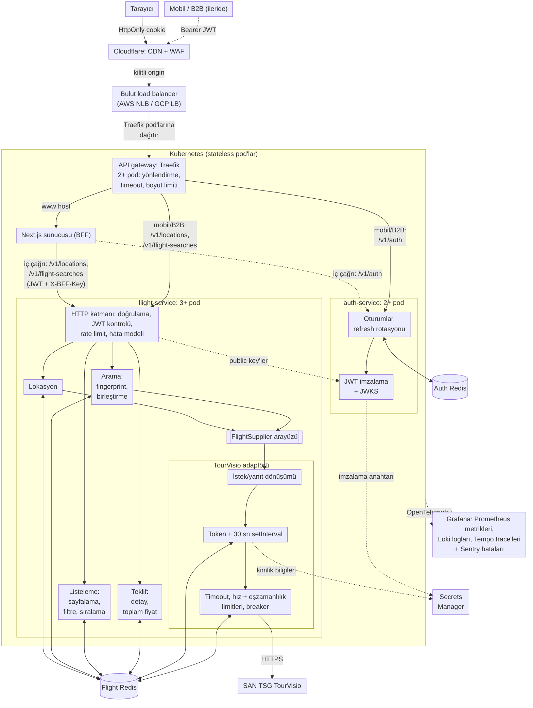
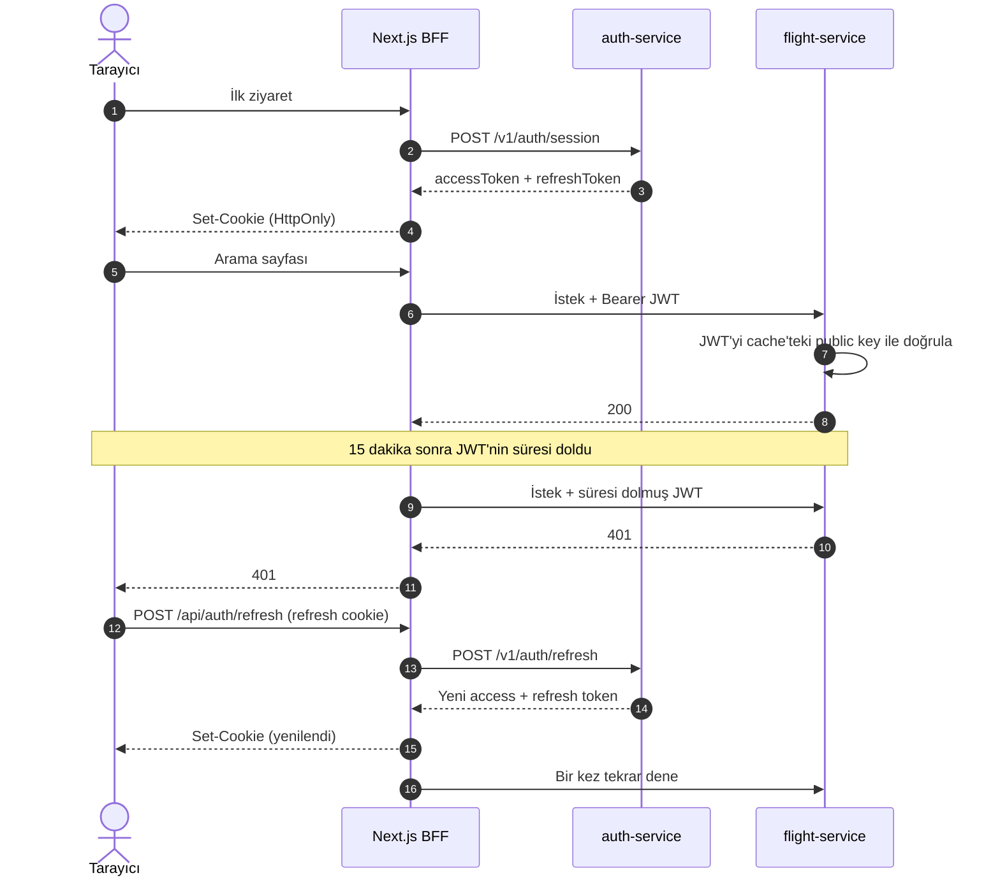
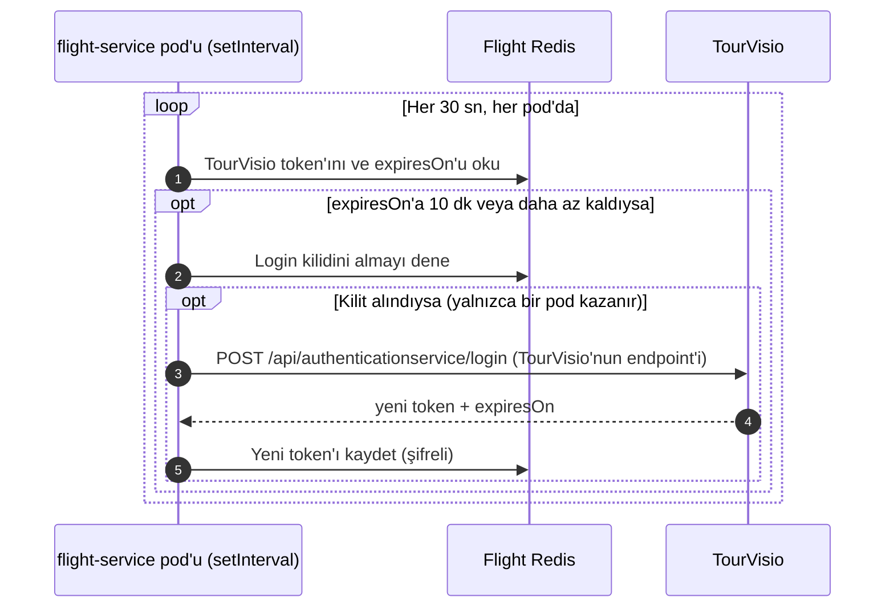
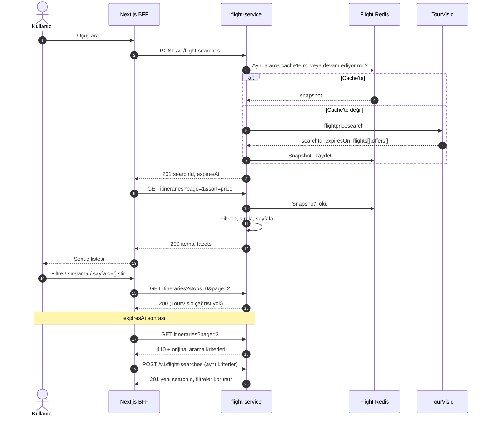
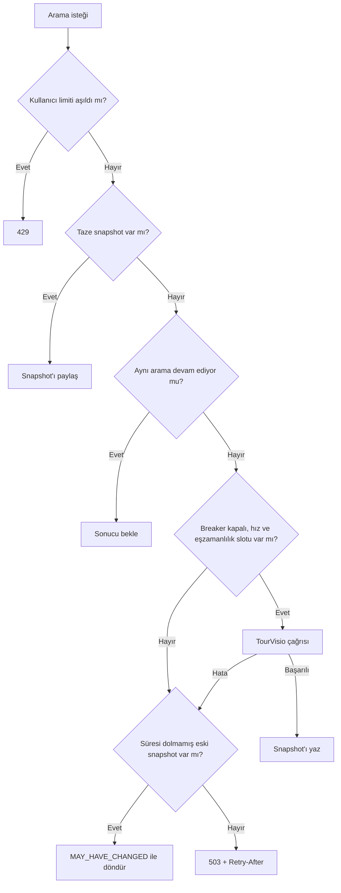

# gidiyorum.com — TourVisio Uçuş API Mimari Planı

> English version: [README.en.md](README.en.md)

> **Kapsam:** lokasyon seçimi → uçuş arama → listeleme → teklif detayı. Rezervasyon ve ödeme kapsam dışı. İleride ayrı bir `booking-service`, seçilen teklifi yeniden doğrulayıp TourVisio rezervasyon akışını (`begintransaction`) başlatacak.

- **İki stateless NestJS servisi:** `auth-service` (oturumlar, JWT) ve `flight-service` (arama, listeleme, teklifler, TourVisio adaptörü).
- **İki ayrı auth katmanı:** Next.js → bizim API'miz JWT + refresh token kullanır. Bizim API'miz → TourVisio, `expiresOn` dolmadan yeniden login olur (TourVisio'da refresh token yok).
- **Listeleme TourVisio'yu hiç çağırmaz:** sonuç Redis'e bir kez kaydedilir (**snapshot**), sayfalama, filtreleme ve sıralama orada yapılır.
- **Darboğaz TourVisio:** cache ve aynı aramaların birleştirilmesi tedarikçi çağrılarını azaltır, global limitler üst sınır koyar.
- **[DOC]** = TourVisio dokümanında yazıyor, **[Q-n]** = [açık soru](#tourvisioya-sorular) ile işaretlenmiş varsayım. Dokümandaki bulgular D1–D12: [docs/tourvisio-findings.md](docs/tourvisio-findings.md).

---

## 1. Teknoloji seçimi

| Katman | Seçim | Neden |
|---|---|---|
| Dil | **TypeScript + NestJS (Fastify)** | İş yükü ağ ağırlıklı, Next.js ile aynı dil ve tipler |
| Servisler | **`auth-service` + `flight-service`** | Yük, secret ve hata davranışları farklı ([Bölüm 2](#2-mimari-şema)) |
| Veritabanı | **İlk fazda yok** | Arama kalıcı veri üretmez. PostgreSQL rezervasyonla gelir |
| Cache | **Redis** (Auth Redis + Flight Redis) | Oturumlar, snapshot'lar, TourVisio token'ı, kilitler, limitler. Ayrı tutuluyor ki arama yükü oturumları etkilemesin |
| Kuyruk | **Aramada yok** | Kullanıcı senkron cevap bekliyor. RabbitMQ rezervasyon event'leriyle gelir |
| Listeleme motoru | **Uygulama içinde, Elasticsearch yok** | Her sonuç küçük, değişmez ve en fazla 15 dk yaşar, bellekte sıralamak milisaniye sürer |
| Edge + gateway | **Cloudflare + bulut load balancer + Traefik** | Edge'de WAF/bot koruması, cluster içinde yönlendirme ve timeout'lar |
| Çalışma ortamı | **Kubernetes** | Servis başına ölçekleme, health check, kesintisiz deploy |
| Gözlemlenebilirlik | **OpenTelemetry → Grafana, Sentry, PostHog** | Next.js'ten TourVisio'ya tek trace, hatalar, arama → teklif hunisi |
| Secret'lar | **AWS Secrets Manager + KMS** (GCP karşılıkları aynı şekilde çalışır) | Servis bazlı erişim, erişim kaydı, rotasyon |

---

## 2. Mimari şema



### Neden iki servis?

| | `auth-service` | `flight-service` |
|---|---|---|
| Yük | Kısa token imzalama | 2–8 sn açık kalan bağlantılar, büyük JSON |
| Secret'lar | JWT private key | TourVisio kimlik bilgileri |
| Veri | Oturumlar | Snapshot'lar, TourVisio token'ı, kilitler |
| Çökerse | Mevcut JWT'ler ≤ 15 dk çalışır | Oturumlar çalışır, arama `503` döner |

- **Arama, listeleme ve teklif birlikte kalır:** aynı snapshot'ı paylaşırlar, ayırmak her listeleme isteğine bir ağ adımı ekler.
- **Kabul edilen maliyet:** iki deployment, anahtar rotasyonu, servisler arası trace.

### Bileşenler

| Bileşen | Bu plandaki karşılığı |
|---|---|
| API gateway | Cloudflare (WAF, bot, TLS) → bulut load balancer → Traefik (yönlendirme, timeout, boyut limiti) |
| Auth | `auth-service` JWT üretir. Her servis JWT'yi kendi içinde doğrular |
| Uçuş servisi | `flight-service`: lokasyon, arama, listeleme, teklif |
| TourVisio adaptörü | `flight-service` içinde, `FlightSupplier` arayüzünün arkasında. TourVisio alanlarını yalnızca adaptör bilir |
| Cache | Flight Redis, Auth Redis, autocomplete için Cloudflare CDN |
| Log / izleme | OpenTelemetry → Grafana (metrik, log, trace), Sentry |

- **Kilitli origin:** load balancer yalnızca Cloudflare IP'lerini ve bizim Cloudflare istemci sertifikamızı kabul eder, kimse WAF'ı atlayamaz.
- **Yük dağıtımı:** load balancer Traefik pod'larına, Traefik de hazır olan tüm servis pod'larına dağıtır. Pod'lar stateless olduğu için her pod her isteği karşılayabilir.

---

## 3. Metot planı

**Ortak kurallar:** temel yol `/v1`. Auth dışındaki her çağrı `Authorization: Bearer <JWT>` ister. Hatalar RFC 9457 `problem+json` formatındadır.

### 3.1 Auth (Next.js → `auth-service`)

| | Oturum aç | Yenile | Çıkış |
|---|---|---|---|
| Endpoint | `POST /v1/auth/session` | `POST /v1/auth/refresh` | `POST /v1/auth/logout` |
| Girdi | — | `refreshToken` | `refreshToken` |
| Çıktı | `accessToken` (15 dk), `refreshToken` (24 sa) | Yeni token çifti | `204` |
| TourVisio | Yok. `flight-service` TourVisio'ya ayrıca login olur ([4.2](#42-flight-service--tourvisio-zamanlayıcıyla-sürekli-oturum)) | Yok | Yok |
| Cache | Refresh token hash'i Auth Redis'te | Eski token kullanıldı olarak işaretlenir | Oturum iptal edilir |
| Hatalar | `429` çok fazla oturum, `503` | `401` süresi dolmuş, tekrar kullanılmış veya 7 günü geçmiş, `503` | `503` |

- **İlk fazda misafir oturumu:** arama için üyelik gerekmez. İleride üye girişi aynı modeli kullanır.
- **Refresh token:** tek kullanımlık, her yenilemede değişir. Oturum 24 saat işlem yapılmazsa veya toplamda **7 gün** sonra biter.

### 3.2 Lokasyon arama

| | Plan |
|---|---|
| Endpoint | `GET /v1/locations/departures?q=ist` · `GET /v1/locations/arrivals?q=ayt&originId=AIRPORT:IST` |
| Girdi | `q` (≥ 2 karakter), `tripType`, `locale`, varış için `originId` |
| Çıktı | `items[]: { id: "AIRPORT:SAW", type, code, name }` |
| TourVisio | `getdepartureautocomplete`, `getarrivalautocomplete` [DOC] |
| Cache | Redis 24 sa + Cloudflare CDN 5 dk |
| Hatalar | `400` hatalı sorgu, `401`, `429`, `502` tedarikçi hatası, `504` timeout |

### 3.3 Uçuş arama

| | Plan |
|---|---|
| Endpoint | `POST /v1/flight-searches` |
| Girdi | `tripType`, `originId`, `destinationId`, `departureDate`, `returnDate?`, `passengers`, `currency` |
| Çıktı | `201`: `searchId`, `resultCount`, `freshUntil`, `expiresAt` |
| TourVisio | `flightpricesearch` [DOC]. Gidiş-dönüş: `ServiceTypes: ["2"]` + `Night` |
| Cache | 3 dk içinde aynı arama tek sonucu paylaşır. Devam eden aynı aramalar tek çağrıda birleştirilir |
| Hatalar | `400`, `401`, `422` geçersiz tarih veya yolcu, `429`, `502`, `503` aşırı yük, `504` timeout |

- Bizim `searchId` kullanıcıya özeldir. TourVisio'nun `searchId`'si sunucuda kalır.

### 3.4 Listeleme

| | Plan |
|---|---|
| Endpoint | `GET /v1/flight-searches/{searchId}/itineraries` |
| Girdi | `page`, `pageSize`, `sort=price\|duration\|departure`, `airlines`, `stops`, `departureFrom/To`, `leg=OUTBOUND\|RETURN` |
| Çıktı | `items[]`, `pagination`, `facets`, `expiresAt` |
| TourVisio | **Yok**: snapshot'tan okur |
| Cache | Redis'teki snapshot, hiç değişmez |
| Hatalar | `400` hatalı filtre, `404` bulunamadı veya size ait değil, `410` süresi doldu |

- Her istek tüm snapshot'ı filtreler → sıralar → sayfalar. Sunucuda durum tutulmaz.
- Gidiş-dönüş: önce gidiş listesi, sonra seçilen gidişle uyumlu dönüşler (`groupKeys`, D8).

### 3.5 Teklif detayı

| | Plan |
|---|---|
| Endpoint | `GET /v1/flight-searches/{searchId}/offers/{offerId}` |
| Girdi | `searchId`, `offerId`, gidiş-dönüş için `returnOfferId` |
| Çıktı | Segmentler, bagaj, paket (brand), yolcu tipine göre fiyat kırılımı, toplam |
| TourVisio | **Yok**: veri `offers[]` içinde (D7) |
| Cache | Aynı snapshot |
| Hatalar | `404`, `410 OFFER_EXPIRED`, `422` uyumsuz gidiş/dönüş |

- **`getfarerules` yok:** rezervasyon işlemi (transaction) gerektirir (D11). Ücret kuralları rezervasyon başlayınca gösterilir.
- **Toplam fiyat** dokümandaki kurala göre hesaplanır (D9):

```text
tek yön:       offer.price + fees.oneWay
gidiş-dönüş:   base = ikisi de paket ? max(out.price, ret.price) : out.price + ret.price
               aynı fees.key ? base + max(out.fees.roundTrip, ret.fees.roundTrip)
                             : base + out.fees.oneWay + ret.fees.oneWay
```

### 3.6 Hata kodları

| HTTP | Ne zaman | İstemci ne yapar |
|---|---|---|
| `401` | JWT süresi doldu | Yenile, bir kez tekrar dene |
| `404` | Arama yok veya başkasına ait | Yeni arama |
| `410` | Sonucun veya teklifin süresi doldu | Otomatik yeniden ara / listeye dön |
| `422` | İş kuralı (tarih, yolcu) | Mesajı göster |
| `429` / `503` | Limit aşıldı veya kapasite yok | `Retry-After` sonrası tekrar dene |
| `502` / `504` | TourVisio hatası / timeout | Kullanıcı tekrar deneyebilir |

---

## 4. Auth ve listeleme akışı

### 4.1 Next.js → backend: JWT + refresh token



| Token | Ömür | Nerede tutulur |
|---|---|---|
| Access JWT | 15 dk | `HttpOnly` cookie. `auth-service`'in public key'i (JWKS) ile doğrulanır |
| Refresh token | 24 sa işlemsiz, en fazla 7 gün | `HttpOnly` cookie, yalnızca `/api/auth`'a gönderilir. Hash'i Auth Redis'te |

- **JavaScript iki token'ı da okuyamaz** (XSS), `SameSite` + `Origin` kontrolü CSRF'i engeller.
- **Çalınan refresh token:** eski bir token'ın tekrar kullanılması tüm oturumu bitirir.
- **Süresi dolunca:** refresh → yeni token çifti. 7 gün sonra → yeni misafir oturumu.

### 4.2 `flight-service` → TourVisio: zamanlayıcıyla sürekli oturum



- **TourVisio'da refresh token yok** [DOC], bu yüzden `expiresOn`'dan 10 dk önce yeniden login oluruz.
- **Saklama:** Flight Redis'te şifreli, tüm pod'lar paylaşır. Her pod bellekte bir kopya tutar.
- **Login başarısız olursa:** eski token hâlâ çalışır. 10 dk'lık pencereye ~20 deneme sığar, ayrıca alarm üretilir.

### 4.3 Arama ve listeleme akışı



### 4.4 Sonuç saklama ve `expiresOn` davranışı

```text
safeExpiry = TourVisio expiresOn - 60 sn             // kullanıcı işlemi ve saat farkı için pay
freshUntil = min(oluşturma + 3 dk,  safeExpiry)      // yeni kullanıcılar paylaşabilir
expiresAt  = min(oluşturma + 15 dk, safeExpiry)      // arayan kullanıcı gezinebilir
```

| Zaman | Aynı yeni arama | Mevcut kullanıcı |
|---|---|---|
| `freshUntil` öncesi | Snapshot'ı paylaşır | `200` |
| `expiresAt`'e kadar | Yeni TourVisio çağrısı | `200`, "fiyatlar değişmiş olabilir" |
| `expiresAt` sonrası | Yeni TourVisio çağrısı | `410` → otomatik yeni arama |

- **Neden yalnızca 3 dk paylaşılıyor:** TourVisio'nun `expiresOn`'u (örneklerde ~210 dk) ID'leri geçerli tutar, koltuk veya fiyatı değil (Q-4).
- **Her teklifin kendi `expiresOn`'u var:** süresi dolan teklifler gizlenir. Birini açmak → `410 OFFER_EXPIRED`.
- **Boş sonuçlar** yalnızca 60 sn cache'lenir, tekrar denemeler kota harcamasın diye.
- **Arama kaydı** (sahip + kriterler) 2 saat tutulur, süresi dolan arama `404` yerine `410` + kriterler döner.

### 4.5 Örnek istek ve yanıtlar

**Arama — `POST /v1/flight-searches`**

```json
{
  "tripType": "ROUND_TRIP",
  "originId": "CITY:IST",
  "destinationId": "AIRPORT:AYT",
  "departureDate": "2027-02-17",
  "returnDate": "2027-02-24",
  "passengers": { "adults": 2, "children": 1, "infants": 0 },
  "currency": "TRY"
}
```

```json
{
  "searchId": "srch_01JD8Z7K4V9YQ2M6T3R5N8P1XA",
  "resultCount": { "outbound": 42, "return": 38 },
  "freshUntil": "2026-11-23T10:03:00Z",
  "expiresAt": "2026-11-23T10:15:00Z"
}
```

**Listeleme — `GET .../itineraries?leg=OUTBOUND&sort=price&stops=0&airlines=TK&page=1&pageSize=20`**

```json
{
  "items": [
    {
      "itineraryId": "itn_7f3a",
      "cheapestOfferId": "off_91c2",
      "airline": { "code": "TK", "name": "Turkish Airlines" },
      "departure": { "airport": "IST", "localTime": "2027-02-17T06:45" },
      "arrival": { "airport": "AYT", "localTime": "2027-02-17T07:55" },
      "durationMinutes": 70,
      "stops": 0,
      "price": { "amount": "2145.90", "currency": "TRY" }
    }
  ],
  "pagination": { "page": 1, "pageSize": 20, "totalItems": 7, "totalPages": 1 },
  "facets": { "airlines": [{ "code": "TK", "count": 5 }], "stops": [{ "value": 0, "count": 7 }] },
  "expiresAt": "2026-11-23T10:15:00Z"
}
```

**Süresi dolmuş — `410`**

```json
{
  "status": 410,
  "code": "SEARCH_EXPIRED",
  "criteria": { "tripType": "ROUND_TRIP", "originId": "CITY:IST", "destinationId": "AIRPORT:AYT", "departureDate": "2027-02-17", "returnDate": "2027-02-24", "passengers": { "adults": 2, "children": 1, "infants": 0 } }
}
```

---

## 5. Sisteme erişim

```text
Tarayıcı → Cloudflare → Load balancer → Traefik → Next.js sunucusu (BFF)
                                                         │ iç çağrı (cluster dışına çıkmaz)
                                                         ▼
Mobil ───→ Cloudflare → Load balancer → Traefik ──→ auth-service / flight-service → TourVisio
B2B ─────→ Cloudflare → Load balancer → Traefik ──┘
```

- **Web, Next.js sunucusunu (BFF) kullanır:** cookie'ler ve SSR Next.js'te kalır. Next.js, API'yi cluster içinden çağırır, çünkü tarayıcı isteği zaten Cloudflare WAF'ından geçmiştir.
- **Mobil ve B2B aynı API'yi** Cloudflare üzerinden çağırır. Yeni servis gerekmez, yalnızca yeni bir kimlik ve limit politikası eklenir.
- **Gerçek kullanıcı IP'si:** mobil/B2B için Cloudflare'in `CF-Connecting-IP` başlığından. Web için Next.js bunu `X-End-User-IP` ile iletir, yalnızca `X-BFF-Key` secret'ı ile birlikte güvenilir.

| İstemci | Kimlik | Limit |
|---|---|---|
| Web | `HttpOnly` cookie'lerde JWT + refresh token | Oturum + IP başına |
| Mobil (ileride) | Aynı token'lar, Keychain/Keystore'da | Kullanıcı/cihaz başına |
| B2B (ileride) | Acente başına client credentials | Sözleşmedeki kota |

### Secret yönetimi

| Secret | Nerede | Kim okuyabilir |
|---|---|---|
| TourVisio acente/kullanıcı/şifre | AWS Secrets Manager | Yalnızca `flight-service` |
| JWT private key | AWS Secrets Manager | Yalnızca `auth-service` (diğerleri public key alır) |
| `X-BFF-Key`, Redis şifreleri | AWS Secrets Manager | Onları kullanan servisler |
| Yolcu verisi anahtarı (ileride) | AWS KMS | İleride `booking-service` |

- **Asla** repoda, imajlarda, loglarda veya `NEXT_PUBLIC_*` değişkenlerinde olmaz. CI'daki secret taraması sızıntıyı engeller.
- **Kesintisiz rotasyon:** servisler secret'ları 10 dk cache'ler ve biri reddedilince yeniden çeker, pod yeniden başlatılmaz. Kısa bir süre eski ve yeni değer birlikte çalışır.

---

## 6. Güvenlik

| Tehdit | Önlem |
|---|---|
| **Bot / scraping** | Cloudflare bot kuralları, oturum ve IP başına limit, şüpheli trafiğe challenge |
| **TourVisio kotasının tükenmesi** | Oturum başına arama limiti, cache, aynı aramaların birleştirilmesi, global tedarikçi limitleri |
| **Token sızıntısı** | 15 dk JWT, `HttpOnly` cookie'ler, refresh tekrar kullanımı oturumu bitirir, TourVisio token'ı sunucudan çıkmaz |
| **Başkasının `searchId`'si** | Rastgele ID + her istekte sahiplik kontrolü → `404`. TourVisio ID'leri hiç dışarı verilmez |
| **WAF'ı atlama** | Origin yalnızca bizim Cloudflare'imizi kabul eder (IP aralıkları + istemci sertifikası) |
| **Sahte IP başlığı** | `X-End-User-IP` yalnızca `X-BFF-Key` ile birlikte güvenilir |
| **Loglarda secret/kişisel veri** | İzin listesine dayalı loglama, tedarikçi yanıtları ham hâliyle loglanmaz |

### KVKK yaklaşımı (ileride yolcu verisi)

- **Yalnızca rezervasyonda toplanır:** arama TCKN, pasaport veya isim saklamaz.
- **Şifreli, ayrı saklama:** kişisel veri Redis'e veya loglara girmez. PostgreSQL'de alan bazında şifrelenir (KMS).
- **Erişim:** en az yetki, maskeli gösterim, erişim kayıtları.
- **Saklama süresi:** belirlenen süre sonunda silinir veya anonimleştirilir.
- **Hukuki süreç:** aydınlatma metni, VERBİS, SAN TSG ile veri işleyen sözleşmesi, yurt dışına aktarım kuralları (md. 9).

---

## 7. Ölçekleme

### 7.1 Yük: darboğaz TourVisio

`Dakikada 3.000 arama = saniyede 50`. Eşzamanlı TourVisio çağrısı = `çağrı/sn × yanıt süresi`.

| Cache tasarrufu | TourVisio çağrı/sn | Eşzamanlı (2 sn) | Eşzamanlı (8 sn) |
|---:|---:|---:|---:|
| %0 | 50 | 100 | **400** |
| **%60 (varsayım)** | **20** | **40** | **160** |

- **Pod eklemek API kapasitesini artırır, tedarikçi kotasını değil.**
- **Redis'te iki global limit:** saniyede 25 yeni çağrı ve aynı anda 200 çağrı. SAN TSG'nin gerçek değerleriyle değiştirilir (Q-3).

### 7.2 Yük altında akış



### 7.3 Dayanıklılık

- **Stateless pod'lar:** her şey Redis'te, pod'lar yatay ölçeklenir (`flight-service` ≥ 3, `auth-service` ≥ 2).
- **Aynı aramaların birleştirilmesi:** ilk istek kısa bir Redis kilidi alıp TourVisio'yu çağırır, diğerleri onun sonucunu bekler. Anahtar, arama kriterlerinin hash'idir. Kullanıcı, sayfa veya filtre anahtara girmez.
- **Timeout'lar:** `Tarayıcı 12 sn > BFF 11 sn > flight-service 10 sn > TourVisio 9 sn`.
- **Timeout'ta tekrar deneme yok:** yavaş tedarikçinin yükünü katlar.
- **Circuit breaker:** %50 hatada açılır, 15 sn sonra tekrar dener.
- **Flight Redis çökerse:** arama durur (`503`), TourVisio'ya kontrolsüz yük gitmez.

### 7.4 Metrikler

| Metrik | Alarm |
|---|---|
| TourVisio p95 gecikme, hata oranı | p95 > 8 sn, hata > %5 |
| Cache hit oranı, tedarikçi çağrısı ÷ arama | Oran > 0,6 |
| TourVisio token'ının kalan süresi | < 5 dk |
| Breaker açık, `503` oranı | 1 dk'dan uzun açık |

---

## Varsayımlar ve açık sorular

### Varsayımlar

- TourVisio JSON örnekleri hangi alanların olduğunu gösterir. Değerleri temsilîdir.
- Tek TourVisio acente hesabı. Yoğun anda %60 cache tasarrufu.
- Ürün ekibi 3 dk paylaşım ve 15 dk gezinme süresini kabul eder.
- Altyapı AWS'de çalışır (GCP karşılıkları aynı şekilde çalışır).

### TourVisio'ya sorular

| # | Soru | Cevap gelene kadar |
|---|---|---|
| Q-1 | Token ömrü ne? Yeni login eski token'ı iptal eder mi? | Eski token `expiresOn`'a kadar geçerli |
| Q-2 | `pricesearch` için token gerçekten gerekmiyor mu? | Her çağrıda token gönderilir |
| Q-3 | Hız limiti, eşzamanlılık limiti, günlük kota? | 25 çağrı/sn, aynı anda 200 |
| Q-4 | `expiresOn` neyi garanti eder: ID'leri mi, koltuğu mu, fiyatı mı? | Yalnızca ID'leri |
| Q-5 | Bir arama sonucu farklı kullanıcılara gösterilebilir mi? | Evet, rezervasyonda yeniden doğrulanır |
| Q-6 | `getoffers` güncel fiyatı teyit eder mi? | Varsayılmaz |
| Q-7 | Rezervasyon başlatmadan ücret kuralları alınabilir mi? | Rezervasyondan önce gösterilmez |
| Q-8 | `flightpricesearch` ile `pricesearch` aynı mı? | `flightpricesearch` |
| Q-10 | Hata kodu listesi? Boş sonuç ile kısmi hata nasıl ayrılır? | Boş liste = başarılı |
| Q-11 | `price` tüm yolcuların toplamı mı? Vergi dahil mi? | Evet, ikisi de |
| Q-12 | Tarihler yerel saat mi UTC mi? `duration` birimi? | Yerel saat, dakika |
| Q-16 | `showOnlyNonStopFlight` ne yapar? | Her zaman `false` gönderilir, filtreyi biz yaparız |
| Q-17 | `fees.key` nedir? Ücret `offer.price`'a dahil mi? | Dahil değil |

---

## Harcanan süre ve yapay zekâ kullanımı

- **Harcanan süre:** her şey dahil 2 saat
- **Yapay zekâ kullanımı:** Claude Code yoğun olarak kullanıldı: dokümanın taslağı, TourVisio dokümantasyonunun incelenmesi, Mermaid şemaları, JSON örnekleri ve ben her bölümü incelerken kavramların açıklanması.
- **Benim verdiğim veya şekillendirdiğim kararlar:**
  - **Mimari:** mikroservis, iki servisle başlayarak (`auth-service` + `flight-service`). Next.js, cluster içinde BFF olarak API'yi içeriden çağırır. Mobil ve B2B aynı API'yi Cloudflare üzerinden kullanır. Gateway olarak bulut load balancer arkasında Traefik.
  - **Auth modeli:** Next.js ile API arasında `HttpOnly` cookie'lerde JWT + refresh token, 7 günlük oturum limiti, TourVisio login'inden ayrı.
  - **TourVisio oturumu:** TourVisio'da refresh token olmadığı için `expiresOn`'dan önce zamanlayıcıyla sürekli yeniden login tasarladım, her pod'da NestJS `setInterval` olarak.
  - **Arama ve listeleme ayrımı:** `POST` TourVisio'yu bir kez çağırır. `GET` kaydedilmiş sonucu sayfalar, filtreler (aktarmasız dahil) ve sıralar. Süresi dolan sonuç yeni bir `POST` başlatır.
  - **Redis'te sonuç saklama:** arama sonuçları bir kez snapshot olarak kaydedilip kullanıcılar arasında paylaşılır, aynı aramalar Redis kilidiyle birleştirilir (bir lider TourVisio'yu çağırır, diğerleri bekler). Cache anahtarına, TourVisio'nun `searchId`'sinin neden anahtar olamayacağına, snapshot ve arama kaydı sürelerine ben karar verdim.
  - **Yeniden başlatmadan secret yönetimi:** servisler secret'ları çekip 10 dakika cache'ler, rotasyonda pod'lar yeniden başlatılmaz.
  - **Limitler ve IP'ler:** TourVisio için ayrı hız ve eşzamanlılık limitleri. Gerçek istemci IP'si Cloudflare'in `CF-Connecting-IP` başlığından.
  - **TourVisio verisi:** örnek veriler kendi içinde tutarsız olduğu için (fiyat, yolcu sayısı ve para birimleri birbirini tutmuyor) örnekleri temsilî kabul ettim.
  - **Format:** planı ödevin istediği kısa, maddeli ve şema ağırlıklı formata indirdim, dokümantasyon bulguları `docs/` klasöründe.
